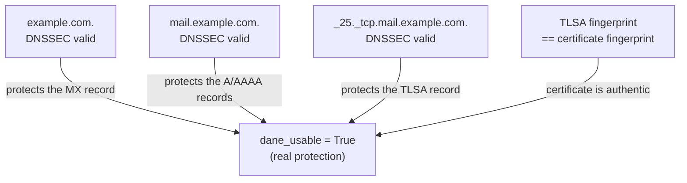

# SMTP Server Checker

A comprehensive Python library and CLI tool for auditing SMTP server security. Performs diagnostic checks covering connectivity, DNS, TLS, open relay, DNSSEC, DANE, and MTA-STS.

## Features

- **14 SMTP tests** – connectivity, DNS, TLS, open relay, session stability, STARTTLS cert capture, TLS cert inspection
- **DNSSEC chain validation** – AD bit (validating resolver) + full cryptographic chain walk as fallback: DS↔DNSKEY hash delegation check **and** RRSIG signature verification over each DNSKEY RRSet via `dns.dnssec.validate()`
- **DANE SMTP** – TLSA record verification against the actual server certificate
- **MTA-STS** – policy fetch and DNS record check
- **TLS-RPT** – `_smtp._tls.<domain>` record inspection
- **Dual input mode** – pass a domain name *or* an MX hostname; auto-detected
- **Certificate reuse** – STARTTLS cert captured during SMTP session is reused for DANE (no extra connection)
- **TLS certificate validation** – hostname match (SAN/CN + wildcard), self-signed detection, expiry check, CA chain trust
- **Async support** – `run_all_tests_async()` and `scan_domains_async()` for concurrent bulk audits
- **Multiple export formats** – JSON and Excel (via pandas)
- **Dual interface** – Python library and CLI tool

## Quick Start

### Installation

```bash
pip install -r requirements.txt
```

### Domain audit (library)

```python
from lib import DomainChecker

report = DomainChecker("flex-led.com").run_all_tests()

# Top-level DNSSEC
print(report["dnssec"]["dnssec_valid"])        # True / False

# MTA-STS
print(report["mta_sts"]["valid"])              # True / False

# Per-MX results
for mx in report["mx_results"]:
    print(mx["hostname"])
    print(mx["smtp"]["tests"]["smtp_tls"]["status"])   # OK / WARNING / PROBLEM
    print(mx["dane"]["dane_valid"])                    # True / False
    print(mx["dane"]["dane_usable"])                   # True if full DNSSEC chain valid
```

### Batch input — list of targets

Both `DomainChecker` and `SMTPChecker` accept a list of targets directly. Pass a list → get a list back; pass a string → get a single dict back (backward compatible).

```python
# DomainChecker — sequential batch
from lib import DomainChecker

results = DomainChecker(["flex-led.com", "granier.be"]).run_all_tests()
for r in results:
    print(r["target"], r["dnssec"]["dnssec_valid"])

# DomainChecker — concurrent batch (async)
import asyncio

results = asyncio.run(
    DomainChecker(["flex-led.com", "granier.be"]).run_all_tests_async()
)

# SMTPChecker — sequential batch
from lib import SMTPChecker

results = SMTPChecker(["mail1.example.com", "mail2.example.com"]).run_all_tests()

# SMTPChecker — concurrent batch (async)
results = asyncio.run(
    SMTPChecker(["mail1.example.com", "mail2.example.com"]).run_all_tests_async()
)
```

### Bulk async audit with concurrency limits

```python
import asyncio
from lib import scan_domains_async, DomainChecker

# Module-level helper — default limits: max_smtp=10, max_dns=50
results = asyncio.run(scan_domains_async(
    ["flex-led.com", "granier.be", "example.com"],
    max_smtp=5,   # at most 5 concurrent SMTP connections
    max_dns=20,   # at most 20 concurrent dns.resolver calls
))

for r in results:
    dnssec = r["dnssec"]["dnssec_valid"] if r["dnssec"] else "N/A"
    print(f"{r['target']:30s}  DNSSEC={dnssec}")

# Same limits via DomainChecker list API
results = asyncio.run(
    DomainChecker(["flex-led.com", "granier.be"]).run_all_tests_async(
        max_smtp=5, max_dns=20
    )
)
```

Set `max_smtp=0` or `max_dns=0` to disable the corresponding limit entirely.

> **Note:** DNS queries made internally by `checkdmarc` (MX lookup, MTA-STS, TLSA retrieval) are not subject to `max_dns`.

### Pure SMTP check (unchanged behaviour)

```python
from lib import SMTPChecker

checker = SMTPChecker(target="mail.example.com")
report = checker.run_all_tests()
print(report["tests"]["smtp_tls"]["status"])
```

### CLI

#### Mode comparison

| | `--mode smtp` (default) | `--mode domain` |
|---|---|---|
| Input | MX hostname / IP | Domain name |
| SMTP tests (14) | ✓ | ✓ (per MX, resolved automatically) |
| DNSSEC | — | ✓ |
| DANE / TLSA | — | ✓ |
| MTA-STS | — | ✓ |
| TLS-RPT | — | ✓ |
| Open relay test | ✓ (with `--sender`/`--recipient`) | ✓ (with `--sender`/`--recipient`) |

`domain` mode is a **superset** of `smtp` mode — it resolves MX records for the domain and runs all SMTP tests against each MX, plus the domain-level DNS checks. There is no "run both" mode: use `domain` to get everything.

The **output format is determined by the file extension** passed to `-o`:
- `-o report.json` → JSON
- `-o report.xlsx` → Excel

```bash
# SMTP mode (default) — direct SMTP checks against a known MX hostname or IP
python cli.py -i mail.example.com -o results.json
python cli.py -i mail.example.com -o results.xlsx   # same scan, Excel output
python cli.py -i servers.txt -o results.xlsx -p 587 -t 15

# SMTP mode with open relay test
python cli.py -i mail.example.com -o results.json \
    --sender probe@yourdomain.com --recipient external@otherdomain.com

# Domain mode — full audit: resolves MX, then DNSSEC + DANE + MTA-STS + TLS-RPT + SMTP tests
python cli.py --mode domain -i example.com -o report.json
python cli.py --mode domain -i domains.txt -o report.xlsx

# Domain mode with open relay test
python cli.py --mode domain -i domains.txt -o report.json \
    --sender probe@yourdomain.com --recipient external@otherdomain.com

# Async scanning (both modes)
python cli.py --mode domain --async-mode -i domains.txt -o report.json

# Custom DNS resolvers (domain mode only)
python cli.py --mode domain -i domains.txt -o report.json \
    --nameservers 1.1.1.1,8.8.8.8

# Convert an existing JSON result to Excel — no re-scan
python cli.py --convert-json report.json -o report.xlsx
```

---

## DANE — `dane_valid` vs `dane_usable`

`smtp_checker` exposes DANE (RFC 6698 / 7672) as two distinct per-MX booleans
(`mx["dane"]`), because **a matching TLSA is worthless if it isn't enforceable**:

| Field | Meaning |
|---|---|
| `dane_valid` | The presented certificate matches at least one published TLSA record (the fingerprint matches). |
| `dane_usable` | DANE is genuinely *enforceable*: all 5 conditions below hold. **This is the only field that matters for a security verdict.** |
| `dane_usable_reason` | When `dane_usable` is `false`, identifies the failing condition (`null` when usable). |

`dane_usable` requires all 5 simultaneously:

1. DNSSEC valid on the parent domain zone (protects the MX record)
2. DNSSEC valid on the MX hostname zone (protects the A/AAAA records)
3. DNSSEC valid on the TLSA zone (the record cannot be stripped)
4. At least one TLSA record exists
5. At least one TLSA matches the server certificate fingerprint

Note the dangerous state: **`dane_valid = True` with `dane_usable = False`** — the
fingerprint matches, but DNSSEC is broken on one of the zones, so the TLSA can be
spoofed. The operator believes DANE protects them; it does not. `smtp_checker` flags
this as the *TLSA without DNSSEC* MITM scenario.

| `dane_usable_reason` | Meaning |
|---|---|
| `parent_domain_unknown` | No mail domain supplied — condition 1 not checkable |
| `parent_domain_dnssec_invalid` | DNSSEC invalid on the domain zone — MX not protected |
| `mx_host_dnssec_invalid` | DNSSEC invalid on the MX zone — A/AAAA not protected |
| `tlsa_dnssec_invalid` | DNSSEC invalid on the TLSA zone — record can be stripped |
| `no_tlsa_records` | No TLSA found under `_25._tcp.<mx_hostname>` |
| `cert_hash_mismatch` | TLSA records exist but none matches the certificate |
| `null` | `dane_usable` is `true` — all conditions met |

### Why all three DNSSEC zones are required



If any one of the three DNSSEC chains breaks, an on-path attacker can spoof the MX,
hijack the IP after MX resolution, or strip/replace the TLSA — so `dane_usable`
becomes `false` as soon as a single link fails.

---

## Project Structure

```
lib/                        # Main package
├── __init__.py             # Exports: SMTPChecker, DomainChecker, scan_domains_async
├── checker.py              # SMTPChecker class (14 SMTP tests incl. TLS cert capture + inspection)
├── config.py               # Default test option flags
├── dane.py                 # DNSSEC / DANE / MTA-STS functions
├── domain_checker.py       # DomainChecker class + scan_domains_async()
└── exceptions.py           # SMTPConnectionError

cli.py                      # CLI tool (SMTPChecker + DomainChecker, sync/async)
test.py                     # Standalone DANE/MTA-STS audit script (reference)
requirements.txt
README.md
CHANGELOG.md
TODOLIST.md
```

---

## CLI Reference

```
python cli.py [-h] -i INPUT -o OUTPUT [--mode {smtp,domain}]
              [--async-mode | --sync-mode]
              [-p PORT] [-t TIMEOUT] [--dns-timeout DNS_TIMEOUT]
              [--nameservers NAMESERVERS]
              [--sender SENDER] [--recipient RECIPIENT]
              [--options OPTIONS]
```

| Flag | Default | Description |
|---|---|---|
| `-i / --input` | — | Target hostname/IP/domain, or a file with one target per line (lines starting with `#` are ignored). Not required with `--convert-json`. |
| `-o / --output` | — | Output file. **Extension determines format**: `.json` → JSON, `.xlsx` → Excel. |
| `--convert-json` | — | Convert an existing JSON result file to Excel without re-running the scan. Use with `-o report.xlsx`. Auto-detects smtp vs domain format. |
| `--mode` | `smtp` | `smtp` → SMTPChecker against MX hostname; `domain` → DomainChecker (resolves MX + full DNS audit). `domain` is a superset of `smtp`. |
| `--async-mode` | off | Scan all targets concurrently |
| `--sync-mode` | on | Scan targets sequentially (default) |
| `-p / --port` | `25` | SMTP port |
| `-t / --timeout` | `10.0` | SMTP connection timeout (seconds) |
| `--dns-timeout` | `5.0` | DNS query timeout (domain mode only) |
| `--nameservers` | `1.1.1.1,8.8.8.8` | Comma-separated DNS resolver IPs (domain mode only) |
| `--sender` | `None` | Sender address for open relay test — works in **both** modes — skipped if not set |
| `--recipient` | `None` | Recipient address for open relay test — works in **both** modes — skipped if not set |
| `--target-type {auto,domain,mx_hostname}` | `auto` | Domain mode: `auto` = a target with MX records is a domain, otherwise an MX hostname; `domain` = always an email domain (no MX → `mx_status` `no_mx` / `nxdomain`, not tested as a mail server); `mx_hostname` = always a mail server |
| `--open-relay-mode {rcpt,data}` | `rcpt` | Open relay test depth: stop after `RCPT TO` (`rcpt`, like MXToolbox) or also send `DATA`, expect `354` and drop the connection without content (`data`, like Nessus) |
| `--max-smtp` | `10` | Max concurrent SMTP connections in async mode (`0` = no limit) |
| `--max-dns` | `50` | Max concurrent DNS resolver calls in async mode, domain mode only (`0` = no limit) |
| `--options` | `None` | JSON file with SMTPChecker test-flag overrides (smtp mode only) |

### Excel output

| Mode | Sheets |
|---|---|
| `smtp` | Single sheet — one row per SMTP test per target |
| `domain` | **Summary** · **MTA-STS** · **SMTP Tests** · **DANE** (see below) |

Domain mode sheets:

| Sheet | One row per | Content |
|---|---|---|
| **Summary** | audited domain | MX hosts, **MX Status** (`mx_status`, e.g. "No MX, no A/AAAA: cannot receive mail"), domain DNSSEC, MTA-STS mode (`enforce` / `testing` / `none` / `invalid`), TLS-RPT present, DANE valid on all MX, MX hosts that are open relays, worst SMTP test status, errors |
| **MTA-STS** | audited domain | `_mta-sts` TXT record, policy id, mode, `max_age`, policy `mx` patterns, the domain's MX hosts and those **not covered** by the policy (RFC 8461 matching: `*.` covers exactly one label), `_mta-sts` DNSSEC, warnings/error, TLS-RPT record and DNSSEC |
| **SMTP Tests** | (MX host, test) | Banner, STARTTLS, certificate (extra columns), reverse DNS, open relay… |
| **DANE** | MX host | MX DNSSEC, TLSA records (`_25._tcp.<mx>`) and their DNSSEC, DANE valid / usable |

SMTP tests and DANE target the **MX server**, not the email domain. An MX shared by
several audited domains is therefore listed **once**: **MX Hostname** is the target, and
**Email Domain Count** / **Email Domains** list the audited domains whose MX points to it.
Rows are merged only when the results are identical. If the same MX answered differently
for two domains (e.g. a temporary error), it keeps one row per distinct result.

The JSON output is unchanged: one report per domain, with the MX results nested under
`mx_results`. The exporter is also available as a library function:
`from smtp_checker.lib import export_domain_results_to_excel` (used by `mail_audit` for
`<name>_smtp.xlsx`).

---

## DomainChecker

### Constructor

```python
DomainChecker(
    target,                 # domain name OR MX hostname
    port=25,
    timeout=10.0,           # SMTP connection timeout (seconds)
    dns_timeout=5.0,        # DNS query timeout (seconds)
    nameservers=None,       # list of resolver IPs, default: ["1.1.1.1", "8.8.8.8"]
    open_relay_sender=None,     # see open relay test below
    open_relay_recipient=None,  # see open relay test below
    smtp_options=None,      # dict to override individual SMTPChecker test flags
    target_type="auto",     # "auto" | "domain" | "mx_hostname" (see below)
)
```

**Target type** (`target_type`, CLI `--target-type`). In `auto` mode (default) a target
with MX records is audited as an **email domain**, any other target as an **MX hostname**
(the mail server itself). An email domain *without* MX is then tested as if it were its own
mail server: with `auto`, `sendgrid.example.com` (no MX) appears in *SMTP Tests* as an MX
host with a "DNS resolution failed" connection error. When the targets are known to be
email domains, use `target_type="domain"`: a domain without MX is then audited as a domain
(DNSSEC, MTA-STS, TLS-RPT) and its **`mx_status`** says why it has no MX row:

| `mx_status` | Meaning | MX tested |
|---|---|---|
| `mx` | MX records found | the MX hosts |
| `implicit_mx` | No MX, but the domain has A/AAAA: RFC 5321 §5.1 implicit MX | the domain itself |
| `no_mx` | No MX and no A/AAAA: the domain cannot receive mail | none |
| `nxdomain` | The name does not exist (e.g. a dangling CNAME) | none |
| `error` | MX lookup failed (error in `errors`) | none |
| `mx_hostname` | The target is a mail server (`auto` without MX, or `mx_hostname`) | the target |

mail_audit always uses `target_type="domain"`.

**Open relay test** (`smtp_open_relay`) — disabled (SKIPPED) when either argument is `None`. To enable it, provide both an external sender and an external recipient that the target server has no legitimate reason to accept:

```python
report = DomainChecker(
    "example.com",
    open_relay_sender="probe@yourdomain.com",    # must have valid MX records
    open_relay_recipient="external@otherdomain.com",
    open_relay_mode="rcpt",                       # or "data" (see below)
).run_all_tests()
```

The test sends `MAIL FROM:<sender>` + `RCPT TO:<recipient>` over the existing SMTP session. If the server accepts both without authentication, it is an open relay (`status: WARNING`, which raises the `smtp_open_relay` issue). A rejection (5xx) is the expected result (`status: OK`).

**Open relay test depth** (`open_relay_mode` / CLI `--open-relay-mode`):

| Mode | Commands sent | Like | Confirms |
|---|---|---|---|
| `rcpt` (default) | `EHLO` → `MAIL FROM` → `RCPT TO` → `RSET` | MXToolbox | the server accepts an external recipient without authentication |
| `data` | … → `RCPT TO` → `DATA` (expects `354`) → **connection dropped** | Nessus | the server is also ready to take the message body |

In `data` mode the connection is closed right after the `354` reply — no header, body or final
`.` is ever sent, so the server discards the incomplete transaction and **nothing is relayed**.
A `RCPT TO` accepted but `DATA` refused is reported `OK` ("relay not confirmed"). The result
carries `mode`, `mail_from_code`, `rcpt_to_code` and, in `data` mode, `data_code`.

### Input auto-detection

| Input has MX records? | Mode | What happens |
|---|---|---|
| Yes | **domain** | Resolves MX hosts, runs SMTP + DANE + domain DNSSEC + MTA-STS + TLS-RPT |
| No | **mx_hostname** | Treats the input as the mail server directly, runs SMTP + partial DANE only |

**`mx_hostname` mode limitations** — MTA-STS, TLS-RPT, and domain DNSSEC all require an *email domain* (e.g. `example.com`), not an MX hostname (e.g. `mail.example.com`). Without the parent domain:

| Field | Value | Why |
|---|---|---|
| `dnssec` | `null` | Domain DNSSEC cannot be determined — we have no email domain |
| `mta_sts` | `null` | MTA-STS lives at `_mta-sts.<domain>` |
| `mta_sts_dns` | `null` | Same as above |
| `smtp_tls_rpt_dns` | `null` | Lives at `_smtp._tls.<domain>` |
| `dane_usable` | `false` | Requires parent domain DNSSEC to verify the MX record is trusted |
| `dane_usable_reason` | `"parent_domain_unknown"` | Explains why `dane_usable` is `false` |
| `dane_valid` | may be `true` | TLSA hash check works on the MX hostname alone — but without DNSSEC protection it is not enforceable |

### Domain-level checks (run once per domain)

| Check | Report key | What it does |
|---|---|---|
| **DNSSEC chain** | `dnssec` | Full chain validation from the ICANN root trust anchor to the domain zone — AD bit (resolver) or local chain walk. See [DNSSEC Chain Validation](#dnssec-chain-validation). |
| **MTA-STS policy** | `mta_sts` | Fetches `https://mta-sts.<domain>/.well-known/mta-sts.txt` and validates the policy (version, mode, max_age, MX entries) via checkdmarc. |
| **MTA-STS DNS record** | `mta_sts_dns` | Checks the `_mta-sts.<domain>` TXT record — DNSSEC chain + raw TXT lookup. |
| **TLS-RPT DNS record** | `smtp_tls_rpt_dns` | Checks the `_smtp._tls.<domain>` TXT record — DNSSEC chain + raw TXT lookup. |
| **MX resolution** | `mx_hosts`, `mx_status` | Resolves the domain's MX records (via checkdmarc), returns the ordered list of MX hostnames; `mx_status` = `mx` / `implicit_mx` / `no_mx` / `nxdomain` / `error` / `mx_hostname` (see *Target type*). |

### Per-MX checks (run for each MX host)

| Check | Report key | What it does |
|---|---|---|
| **SMTP tests** | `mx_results[n].smtp` | Runs all enabled SMTPChecker tests against the MX host — see [SMTPChecker — SMTP tests](#smtpchecker--smtp-tests). |
| **TLS cert capture** | *(internal — hidden from report)* | `smtp_starttls_cert` is auto-enabled: performs STARTTLS with `CERT_NONE` to capture the DER certificate without validating it. The cert is stored in `checker.tls_cert_der` and reused by DANE and the cert check — no extra SMTP connection needed. |
| **TLS cert check** | `mx_results[n].smtp.tests.smtp_tls_cert_check` | `smtp_tls_cert_check` is auto-enabled: full certificate inspection — hostname match, self-signed detection, expiry, CA chain trust. See details below. |
| **DANE** | `mx_results[n].dane` | TLSA record retrieval + cert hash match + three DNSSEC chain checks. See [DANE SMTP Verification](#dane-smtp-verification). |

### smtp_tls_cert_check — sub-checks

Uses the cert captured internally for static analysis (no extra SMTP connection), then opens one additional STARTTLS connection with strict CA validation for the chain check.

| Sub-check | Field | What it verifies |
|---|---|---|
| **Hostname match** | `cert_hostname_match` | The server's hostname appears in the certificate's SANs (dNSName or iPAddress). Wildcard SANs (`*.example.com`) are supported. Falls back to Subject CN if no SAN extension is present. |
| **Self-signed** | `cert_self_signed` | True only when **both**: issuer DN == subject DN **and** the certificate's signature is cryptographically verifiable with the certificate's own public key. Supports RSA and ECDSA. |
| **Expiry** | `cert_days_remaining`, `cert_not_after` | PROBLEM if already expired or < 14 days remaining; WARNING if < 30 days. |
| **CA chain** | `cert_ca_valid`, `cert_ca_error`, `cert_ca_error_type` | Opens a second STARTTLS connection with full chain validation using the `certifi` Mozilla root store. Error types: `incomplete_chain`, `self_signed`, `expired`, `hostname_mismatch`, `untrusted_ca`. |
| **AIA issuer URL** | `cert_issuer_url` | CA Issuers URL from the Authority Information Access extension — helps diagnose missing intermediates (e.g. Let's Encrypt R12). |

### Report structure

```json
{
  "target": "flex-led.com",
  "target_type": "domain",
  "domain": "flex-led.com",
  "nameservers": ["1.1.1.1", "8.8.8.8"],
  "scan_timestamp": "2025-12-01T12:00:00Z",
  "dnssec": {
    "name": "flex-led.com",
    "zone": "flex-led.com",
    "dnskey_present": true,
    "ds_present": true,
    "ds_dnskey_match": true,
    "dnssec_valid": true,
    "matched_ds": { "key_tag": 1234, "algorithm": 13, "digest_type": 2, "digest": "..." },
    "validation_method": "ad_bit"
  },
  "mta_sts": { "valid": true, "id": "...", "policy": { ... } },
  "mta_sts_dns": { "owner": "_mta-sts.flex-led.com", "dnssec": { ... }, "txt_lookup": { ... } },
  "smtp_tls_rpt_dns": { "owner": "_smtp._tls.flex-led.com", "dnssec": { ... }, "txt_lookup": { ... } },
  "mx_hosts": ["bobmail.de-sono.com"],
  "mx_status": "mx",
  "mx_results": [
    {
      "hostname": "bobmail.de-sono.com",
      "smtp": {
        "target": "bobmail.de-sono.com",
        "port": 25,
        "tests": {
          "smtp_connect": { "ok": true, "status": "OK", "details": "..." },
          "smtp_tls":     { "ok": true, "status": "OK", "details": "STARTTLS advertised." },
          "smtp_tls_cert_check": {
            "ok": true, "status": "OK",
            "cert_hostname_match": true,
            "cert_self_signed": false,
            "cert_days_remaining": 82,
            "cert_not_after": "2025-06-15T00:00:00",
            "cert_ca_valid": true,
            "cert_ca_error": null,
            "cert_issuer_url": "http://r12.i.lencr.org/"
          }
        },
        "session_transcript": "[I] Connecting...\n[S] 220 ..."
      },
      "dane": {
        "hostname": "bobmail.de-sono.com",
        "mx_dnssec":     { "dnssec_valid": true, ... },
        "address_lookup":{ "A": { ... }, "AAAA": { ... }, "dnssec": { ... } },
        "tlsa_lookup":   { "owner": "_25._tcp.bobmail.de-sono.com", "dnssec": { ... }, "raw_lookup": { ... } },
        "tlsa_records_validated": ["3 1 1 b3d31..."],
        "certificate_retrieved": true,
        "dane_matches": [{ "match": true, "expected": "b3d31...", "computed": "b3d31..." }],
        "dane_valid": true,
        "dane_usable": true,
        "dane_usable_reason": null
      }
    }
  ],
  "errors": []
}
```

### dane_valid vs dane_usable

| Field | Meaning |
|---|---|
| `dane_valid` | The certificate hash matches at least one TLSA record |
| `dane_usable` | DANE is actually *enforceable*: all 5 conditions below are met |
| `dane_usable_reason` | When `dane_usable` is `false`, identifies which condition failed (see table below). `null` when `dane_usable` is `true`. |

`dane_usable` requires all 5 conditions to be true simultaneously:

1. Parent domain DNSSEC valid (MX record is protected from spoofing)
2. MX hostname DNSSEC valid (A/AAAA records are protected from hijacking)
3. TLSA zone DNSSEC valid (TLSA record cannot be stripped or replaced)
4. At least one TLSA record exists
5. At least one TLSA record matches the server's certificate hash

| `dane_usable_reason` value | Meaning |
|---|---|
| `"parent_domain_unknown"` | Called in `mx_hostname` mode — no email domain provided, condition 1 cannot be verified |
| `"parent_domain_dnssec_invalid"` | Domain zone DNSSEC is not valid — MX record is not protected |
| `"mx_host_dnssec_invalid"` | MX hostname zone DNSSEC is not valid — A/AAAA records are not protected |
| `"tlsa_dnssec_invalid"` | TLSA zone DNSSEC is not valid — the TLSA record could be stripped |
| `"no_tlsa_records"` | No TLSA records found at `_25._tcp.<mx_hostname>` |
| `"cert_hash_mismatch"` | TLSA records exist but none match the server certificate |
| `null` | `dane_usable` is `true` — all conditions met |

Without DNSSEC on the TLSA record an attacker on the path can strip the record to force plain-text delivery. `dane_usable` is the meaningful value for security assessments.

---

## DNSSEC Chain Validation

DNSSEC (DNS Security Extensions) allows a resolver to verify that DNS records have not been tampered with.  It relies on a chain of cryptographic signatures rooted at the DNS root zone.

### Key concepts: RRSet and RRSIG

A **RRSet** (Resource Record Set) is the set of all DNS records of the same type at the same owner name.  Examples: the `DNSKEY` RRSet at `example.com.` (all DNSKEY records for that zone), the `MX` RRSet at `example.com.`, the `TLSA` RRSet at `_25._tcp.mail.example.com.`

In DNSSEC, what gets *signed* is always an entire RRSet — not individual records.  The signature is stored in an **RRSIG** record at the same owner name.  Each zone typically uses two key roles:

| Key role | Flags | Purpose |
|---|---|---|
| **KSK** (Key Signing Key) | 257 | Signs the zone's own **DNSKEY RRSet** (self-signing) |
| **ZSK** (Zone Signing Key) | 256 | Signs all other RRSets (MX, A, TLSA, TXT …) |

The **DS** (Delegation Signer) record in the *parent* zone is a hash of the child zone's **KSK**.  This creates a verifiable chain: parent pins the child's KSK via DS → KSK signature on DNSKEY RRSet is verified → ZSK is trusted → all other records in the zone are verified via their RRSIG.

### How the chain works

::: mermaid
graph TD
    ROOT["<b>. (root zone)</b><br/>DNSKEY RRSet: root KSK + ZSK<br/>RRSIG(DNSKEY): KSK self-signs the RRSet<br/><i>bootstrapped via key-tag 20326 — RFC 7958</i>"]
    TLD["<b>com. (TLD zone)</b><br/>DNSKEY RRSet: KSK + ZSK<br/>RRSIG(DNSKEY): KSK self-signs the RRSet"]
    DOMAIN["<b>example.com. (domain zone)</b><br/>DNSKEY RRSet: KSK + ZSK<br/>RRSIG(DNSKEY): KSK self-signs the RRSet"]
    RECORDS["DNS records<br/>MX, A, AAAA, TLSA, TXT ...<br/>RRSIG(type): each RRSet signed by ZSK"]

    ROOT -->|"DS(com.) = hash(KSK_com)<br/>published in root zone"| TLD
    TLD -->|"DS(example.com.) = hash(KSK_domain)<br/>published in com. zone"| DOMAIN
    DOMAIN -->|"RRSIG(MX/A/TLSA…) = sign(ZSK, RRSet)"| RECORDS
:::

Each DS arrow pins the **child KSK** by digest — this is the *delegation chain*.  The RRSIG on the DNSKEY RRSet proves that the RRSet itself has not been tampered with — this is the *signature chain*.  Both must hold for full DNSSEC integrity.

### What `check_dnssec_chain()` checks

For a given name (e.g. `example.com` or `_25._tcp.mail.example.com`) the function uses a **two-stage strategy**:

**Stage 1 — AD bit (primary)**

The query is sent with the DNSSEC-OK (DO) flag.  A validating recursive resolver (1.1.1.1, 8.8.8.8) sets the **AD (Authenticated Data)** bit in the response when it has already verified the full cryptographic chain all the way to the ICANN root trust anchor.  If the AD bit is set, `dnssec_valid` is immediately `True` (`validation_method = "ad_bit"`).

**Stage 2 — Chain walk (fallback)**

If the AD bit is not set (non-validating resolver, or the zone only partially deploys DNSSEC), the function walks **every zone level from the root down** to the target zone.  At each hop **two independent checks** are performed:

- **DS ↔ DNSKEY hash** — `dns.dnssec.make_ds(zone, dnskey, digest_type)` is recomputed and compared against the DS record published in the parent zone (key_tag, algorithm, digest_type, digest must all match).  This verifies the *key delegation chain*: the parent endorsed this child KSK.
- **RRSIG over DNSKEY RRSet** — `dns.dnssec.validate(dnskey_rrset, rrsig_rrset, {zone: dnskey_rrset})` is called to cryptographically verify the RRSIG signature covering the DNSKEY RRSet.  The KSK self-signs the DNSKEY RRSet; this proves the RRSet itself has not been substituted.  Without this check, an attacker who can forge DS records could serve a fake DNSKEY RRSet that matches the DS hash but has no valid signature.

At the root, the trust anchor bootstrap works as follows: at least one DNSKEY key-tag must match a hardcoded ICANN anchor (key tags **19036** / **20326**, RFC 7958) to identify which key to trust, then the RRSIG over the root DNSKEY RRSet is still verified with `dns.dnssec.validate()`.

The RRSIG is extracted from the DNS response (included by the server when the query carries the DO flag) via `_extract_rrsig_covering(response, DNSKEY)`.  If no RRSIG is present in the response, the chain walk fails — the zone is considered not fully signed.

::: mermaid
sequenceDiagram
    participant C as check_dnssec_chain()
    participant R as DNS resolver (1.1.1.1 / 8.8.8.8)

    C->>R: SOA walk (iterative) → find authoritative zone
    R-->>C: zone = "example.com."

    Note over C: Set DNSSEC-OK (DO) flag on resolver
    C->>R: DNSKEY? example.com. [+DO flag]
    R-->>C: [DNSKEY RRSet] — AD bit may be set in response header

    alt AD bit = 1 in response flags
        Note over C,R: Resolver already verified the full chain:<br/>root KSK → DS(com.) → DNSKEY(com.)<br/>→ DS(example.com.) → DNSKEY(example.com.)
        Note over C: dnssec_valid = True<br/>validation_method = "ad_bit"

    else AD bit = 0 — full local chain walk
        Note over C: Build zone chain: [".", "com.", "example.com."]

        C->>R: DNSKEY? . [+DO]
        R-->>C: [root DNSKEY RRSet] + [RRSIG(DNSKEY)]
        Note over C: make_ds(., KSK, SHA256).key_tag ∈ {19036, 20326} → trust anchor ✓
        Note over C: dns.dnssec.validate(DNSKEY_RRSet, RRSIG, {"." → DNSKEY_RRSet}) → RRSIG ✓

        C->>R: DNSKEY? com. [+DO]
        R-->>C: [com. DNSKEY RRSet] + [RRSIG(DNSKEY)]
        C->>R: DS? com. (stored in root zone)
        R-->>C: {key_tag, algo=13, digest_type=2, digest="..."}
        Note over C: make_ds("com.", KSK_com, 2) == DS ? → hash ✓
        Note over C: dns.dnssec.validate(DNSKEY_RRSet, RRSIG, {"com." → DNSKEY_RRSet}) → RRSIG ✓

        C->>R: DNSKEY? example.com. [+DO]
        R-->>C: [domain DNSKEY RRSet] + [RRSIG(DNSKEY)]
        C->>R: DS? example.com. (stored in com. zone)
        R-->>C: {key_tag=17856, algo=13, digest_type=2, digest="52076e..."}
        Note over C: make_ds("example.com.", KSK, 2) == DS ? → hash ✓
        Note over C: dns.dnssec.validate(DNSKEY_RRSet, RRSIG, {"example.com." → DNSKEY_RRSet}) → RRSIG ✓
        Note over C: dnssec_valid = True / validation_method = "chain_walk"
    end
:::

> DS digest types: **1** = SHA-1 (deprecated), **2** = SHA-256 (standard), **4** = SHA-384.  Algorithms: **8** = RSASHA256, **13** = ECDSAP256SHA256 (most common).

| Output field | Meaning |
|---|---|
| `dnskey_present` | At least one DNSKEY record exists in the zone |
| `ds_present` | A DS record exists in the parent zone |
| `ds_dnskey_match` | The DS digest matches at least one DNSKEY (hash check passed) |
| `dnssec_valid` | Full chain verified: either by AD bit, or by chain walk (DS hash + RRSIG signature at every level) |
| `matched_ds` | The DS record that matched — key_tag, algorithm, digest_type, digest |
| `validation_method` | `"ad_bit"` — resolver verified the full chain including all RRSIGs; `"chain_walk"` — verified locally (DS↔DNSKEY hash + `dns.dnssec.validate()` on each DNSKEY RRSet); `null` — DNSSEC absent |

> **Algorithm 13** (ECDSAP256SHA256) is the most common in modern zones. Algorithm 8 (RSASHA256) is also common in older zones.

---

## DANE SMTP Verification

DANE (DNS-Based Authentication of Named Entities, RFC 7671) allows a mail server to publish its TLS certificate (or a hash of it) in a DNSSEC-signed TLSA record.  A sending server can verify the certificate it receives matches the published record — without relying on a public CA.

### DNS records involved

```
  example.com.          MX  10  mail.example.com.
                                      |
                                      v
  _25._tcp.mail.example.com.  TLSA  <usage> <selector> <matching_type> <hash>
```

The TLSA record lives under `_25._tcp.<mx_hostname>` (port 25, TCP).

### TLSA record format

```
  3   1   1   b3d31ccbd6d607d7fb2917342f2bfcd8aaa4312189590c238649f6058147cb9b
  |   |   |   |
  |   |   |   +-- hash value (hex)
  |   |   +------ matching type:
  |   |             0 = full certificate/SPKI bytes (raw DER)
  |   |             1 = SHA-256 of the selected bytes
  |   |             2 = SHA-512 of the selected bytes
  |   +---------- selector:
  |                 0 = full certificate DER
  |                 1 = SubjectPublicKeyInfo (SPKI) only — survives cert renewal
  +-------------- usage:
                    3 = DANE-EE  (domain-issued cert, no CA validation needed)
                    2 = DANE-TA  (trust anchor, domain acts as its own CA)
                    1 = PKIX-EE  (must also validate against public CA)
                    0 = PKIX-CA  (CA cert pinning with public CA validation)
```

`3 1 1` (DANE-EE / SPKI / SHA-256) is by far the most common combination. It pins the server's public key hash — the certificate can be renewed without changing the TLSA record as long as the key pair stays the same.

### Verification flow

::: mermaid
sequenceDiagram
    participant V as verify_mx_dane()
    participant DNS as DNS resolver
    participant MX as Mail Server (SMTP)

    V->>DNS: MX? example.com
    DNS-->>V: mail.example.com (priority 10)
    V->>DNS: DNSSEC chain — example.com.
    DNS-->>V: dnssec_valid=True (protects MX record)
    V->>DNS: DNSSEC chain — mail.example.com.
    DNS-->>V: dnssec_valid=True (protects A/AAAA records)
    V->>DNS: TLSA? _25._tcp.mail.example.com.
    DNS-->>V: "3 1 1 b3d31..." (DNSSEC-signed)
    V->>DNS: DNSSEC chain — _25._tcp.mail.example.com.
    DNS-->>V: dnssec_valid=True (protects TLSA record)
    V->>MX: TCP :25 + EHLO + STARTTLS
    MX-->>V: TLS certificate (DER, CERT_NONE)
    Note over V: selector=1 → extract SPKI from cert<br/>matching_type=1 → SHA-256(SPKI)<br/>= "b3d31..."
    V->>V: "b3d31..." == "b3d31..." ?
    Note over V: dane_valid = True<br/>all 3 DNSSEC chains valid<br/>→ dane_usable = True
:::

### Why all three DNSSEC zones are required for `dane_usable`

::: mermaid
graph TD
    D1["example.com. DNSSEC valid"]
    D2["mail.example.com. DNSSEC valid"]
    D3["_25._tcp.mail.example.com. DNSSEC valid"]
    H["TLSA hash == cert hash"]
    U["dane_usable = True"]

    D1 -->|"protects MX record<br/>prevents MX spoofing"| U
    D2 -->|"protects A/AAAA record<br/>prevents IP hijack"| U
    D3 -->|"protects TLSA record<br/>prevents record stripping"| U
    H -->|"certificate is authentic"| U
:::

If any of the three DNSSEC chains is broken, an attacker on the path can:
- Spoof `example.com.` MX → redirect all inbound mail to their server
- Spoof `mail.example.com.` A → hijack the TCP connection after MX resolution
- Strip or replace the TLSA record → force plain-text delivery or substitute their certificate

`dane_usable = False` whenever any condition is not met.

---

## SMTPChecker — SMTP tests

`SMTPChecker` is a standalone class that tests a single MX hostname or IP address directly over SMTP. It has no knowledge of DNS zones, DNSSEC, DANE, or MTA-STS — those are `DomainChecker`'s responsibility.

All tests are individually togglable via the `options` dict:

```python
checker = SMTPChecker(
    target="mail.example.com",
    options={
        "smtp_starttls_cert": True,   # enable optional cert capture
        "smtp_tls_cert_check": True,  # enable optional cert inspection
        "smtp_connection_time": True, # enable timing
    }
)
```

`DomainChecker` uses `SMTPChecker` internally for each resolved MX host and automatically sets `smtp_starttls_cert=True` and `smtp_tls_cert_check=True`.

| Test key | Description | Default |
|---|---|---|
| `smtp_connect` | Opens a TCP connection and reads the SMTP banner (220 greeting). Fails if the server is unreachable or returns an unexpected banner. | ✅ |
| `smtp_banner_check` | Compares the hostname in the SMTP banner against the PTR record of the server IP. A mismatch is a common spam indicator. | ✅ |
| `smtp_dns_resolution` | Resolves the target hostname to an IP (A/AAAA). Fails if the hostname cannot be resolved. | ✅ |
| `smtp_reverse_dns_resolution` | Checks that a PTR record exists for the server IP. Missing PTR records cause many receiving servers to reject or flag email. | ✅ |
| `smtp_valid_hostname` | Verifies the PTR hostname is syntactically valid (not an IP literal, not a bare label). | ✅ |
| `smtp_reverse_dns_mismatch` | Resolves the banner hostname forward (A/AAAA) and checks it matches the server's actual IP. Detects banner/IP disagreements. | ✅ |
| `smtp_reverse_lookup` | Full forward-confirmed reverse DNS: resolves the PTR hostname back to an IP and confirms it matches the server IP (FCrDNS). | ✅ |
| `smtp_tls` | Sends EHLO and checks that `STARTTLS` is advertised. A missing STARTTLS means mail is delivered in plain text. | ✅ |
| `smtp_open_relay` | Attempts to relay a message from a foreign sender to a foreign recipient. A successful relay is a critical misconfiguration that enables spam abuse. Skipped unless both `open_relay_sender` and `open_relay_recipient` are provided. | ✅ |
| `smtp_server_disconnected` | Sends a NOOP after the initial tests and checks the server responds correctly. Detects unstable servers that drop connections mid-session. | ✅ |
| `smtp_connection_time` | Time in milliseconds to establish the TCP connection and receive the banner. Purely informational. | ❌ |
| `smtp_transaction_time` | Round-trip time for a full EHLO + MAIL FROM + RCPT TO sequence. Useful to detect slow or throttled servers. | ❌ |
| `smtp_starttls_cert` | Performs STARTTLS with `CERT_NONE` (accepts any cert) and stores the raw DER certificate in `checker.tls_cert_der`. Required by `smtp_tls_cert_check` and by `DomainChecker`'s DANE verification. Runs last so it does not disrupt earlier plain-text SMTP tests. | ❌ |
| `smtp_tls_cert_check` | Full TLS certificate inspection: hostname match, self-signed detection, expiry, CA chain trust. Reuses the cert from `smtp_starttls_cert` if available (no extra SMTP connection), otherwise opens its own STARTTLS. For sub-check details see `DomainChecker` section above. | ❌ |

---

## Async Usage

### Single domain

```python
import asyncio
from lib import DomainChecker

report = asyncio.run(DomainChecker("flex-led.com").run_all_tests_async())
```

### Bulk concurrent scan

```python
import asyncio, json
from lib import scan_domains_async

async def main():
    results = await scan_domains_async(
        ["flex-led.com", "granier.be"],
        open_relay_sender="test@gmail.com",
        open_relay_recipient="external@otherdomain.com",
    )
    with open("report.json", "w") as f:
        json.dump(results, f, indent=2)

asyncio.run(main())
```

---

## Security Notes

- `dane_usable` requires DNSSEC on the parent domain zone, MX host zone, and TLSA owner zone.
- STARTTLS certificate capture uses `CERT_NONE` (accepts self-signed certs) because DANE is the mechanism that validates the cert — not the CA chain.
- Never test servers without permission.

---

## Requirements

| Package | Purpose |
|---|---|
| `dnspython` | DNS resolution and DNSSEC |
| `checkdmarc` | MX lookup, TLSA record retrieval, MTA-STS |
| `cryptography` | X.509 certificate parsing for DANE |
| `pandas` + `openpyxl` | Excel export (CLI) |

```bash
pip install -r requirements.txt
```

---

## Status Values

- **OK** – test passed
- **WARNING** – potential issue detected
- **PROBLEM** – test failed or hard error
- **SKIPPED** – test not applicable or disabled

---

## Migration from v1

`SMTPChecker` is unchanged except for one new optional test (`smtp_starttls_cert`, off by default). Existing code using `SMTPChecker` directly requires no changes.

```python
# v1 — still works
from lib import SMTPChecker
checker = SMTPChecker(target="mail.example.com")
report = checker.run_all_tests()

# v2 — new
from lib import DomainChecker
report = DomainChecker("example.com").run_all_tests()
```
